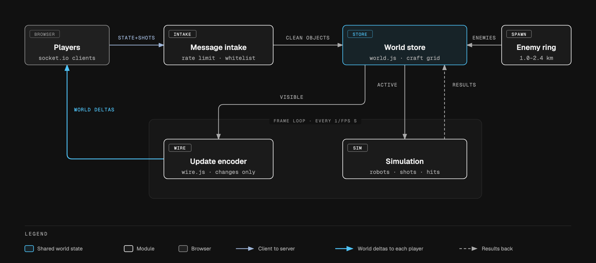
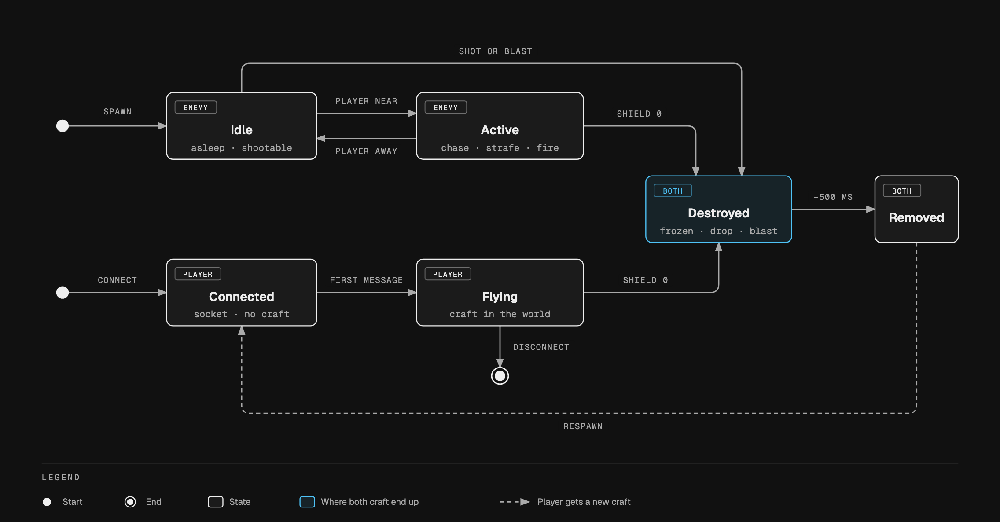
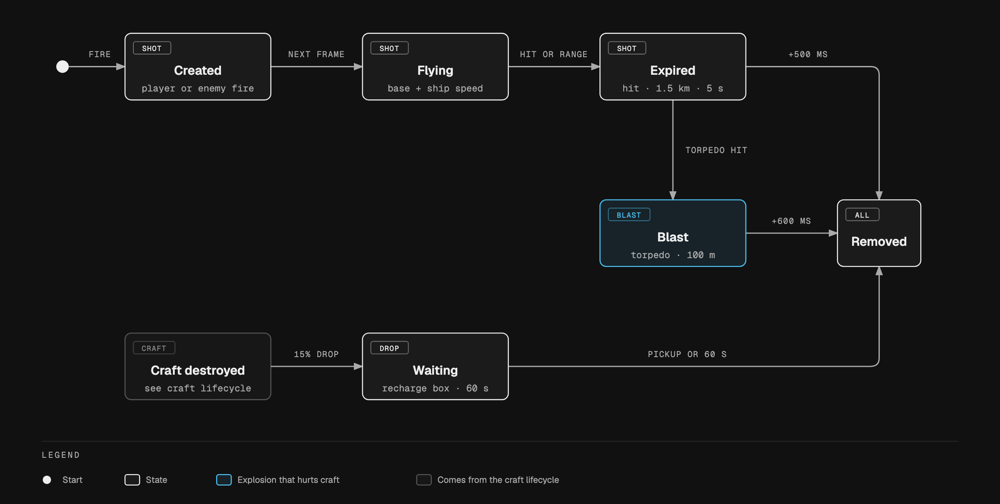

# The Flock Network
A simple (socket.io) websocket server for managing [the-flock](https://github.com/yapalexei/the-flock) client connections.

## Prerequisites
- node >= 20
- [pnpm](https://pnpm.io) (`corepack enable`)
- (optional) Docker

## Setup and run steps
- `pnpm install`
- `pnpm start`
- OR (optionally) `pnpm docker`

## Configuration (env vars)
| Var | Default | Notes |
| --- | --- | --- |
| `PORT` / `HOST` | `3001` / `0.0.0.0` | Railway injects `PORT`. |
| `ALLOWED_ORIGINS` | `http://localhost:9000,http://127.0.0.1:9000` | Comma separated browser origins allowed to connect. Set to the public URL of the client when hosting. `*` allows all. |
| `MAX_CONNECTIONS` | `100` | Extra connections are dropped. |
| `MAX_MSGS_PER_SEC` | `120` | Per-socket message budget; excess is ignored. |
| `ALLOW_RESET` / `RESET_COOLDOWN_MS` | `1` / `30000` | The client "g-o-d" key combo resets the world for everyone; set `ALLOW_RESET=0` on a public host. |
| `FPS`, `ROBOTS`, `HIDE_OBJS_PAST_RADIUS`, `ENABLE_ENEMY_SHOOTING`, `PRINT_STATS_TO_CONSOLE` | see `docker-compose.yml` | Game tuning. `0` now really means off. |
| `ENEMY_RING_INNER_M` / `ENEMY_RING_OUTER_M` | `1000` / `2400` | Enemies spawn spread evenly over a ring around the start, this many metres from it at nearest and farthest. They replace the old `ROBOT_SPAWN_PLACEMENT_OFFSET`, which is now ignored. |
| `GAME_CENTER_LNG` / `GAME_CENTER_LAT` | Portland (`-122.6712`, `45.5206`) | Where players start and the ring is centred. Sent to the client as `gameCenter`. |
| `DROP_CHANCE` | `0.05` | Chance (0-1) that a destroyed robot drops a recharge box. Flying a player craft over it restores half its shield capacity; unclaimed boxes vanish after 60s. |
| `PROJECTILE_MAX_RANGE_KM` | `1.5` | Shots (lasers, torpedoes, enemy fire) are expired after flying this far; the screen only shows about 1km around a player. |

Torpedo, blast and craft-explosion tuning are constants at the top of `src/server/index.js` (`TORPEDO_*`, `CRAFT_EXPLOSION`); enemy flight tuning is at the top of `src/server/flight.js` and enemy-vs-enemy avoidance (`AVOID_OUTER_M`, `COLLISION_INNER_M`, collision damage) at the top of `src/server/avoidance.js`.

Live objects are kept in a persistent store (`src/server/world.js`): sets per kind, updated in place, with the craft (players and enemies) also in a grid of about 280 m cells, so nothing is rebuilt or filtered every frame. Enemies are only simulated (target, avoidance, flight, shooting) while within a box around a living player: the chase range (`CHASE_RADIUS`) plus a margin (`ACTIVE_BOX_DEG`, top of `src/server/index.js`). Enemies outside it sit still but can still be shot, blasted and seen. Hit detection asks the grid for the craft near each shot, and a shot hits the nearest craft within its reach; blasts do the same with their radius.

Shots fired by players fly at the base speed (`PROJECTILE_DISTANCE_TRAVELLED_PER_FRAME`) plus the shooter's speed when firing (the client sends `shipSpeed` in m/s; the server caps it at `MAX_SHIP_SPEED_MPS`), so a shot is never slower than its craft, turbo included. Because fast shots can cover more than a craft's hit window in one frame, a shot hits the first craft along the path it flew that frame, not just whatever is at its end point.

What players receive (`src/server/wire.js`): a `world` event per player with only what changed since the last one (`u` new/changed objects, `d` ids that left their view, `s` = full snapshot after connecting or a client `resync`). Objects are trimmed to the fields the client draws, with short keys and small integer ids, and each is compared and JSON-encoded at most once per frame however many players see it. The packet is handed straight to the engine (`socket.conn.send` of a ready-made socket.io event), so the format is described at the top of `wire.js` and decoded by `world-wire.js` in the client; change both together. Visibility is a grid lookup with the same rule as before (`HIDE_OBJS_PAST_RADIUS`).

`GET /health` returns 200 (use as the Railway healthcheck).

## How it works

Data flow: a player message is checked at the intake and stored; every frame the simulation updates the store and the encoder sends each player what changed near them.

Players and enemies: enemies sleep until a player is near; both end as Destroyed, are removed 500 ms later, and a player then gets a new craft.

Shots, drops and blasts: all of them are short-lived and swept out of the store after a short time.

The diagrams are HTML with inline SVG in `docs/diagrams/`; the PNGs above are exports of them.
